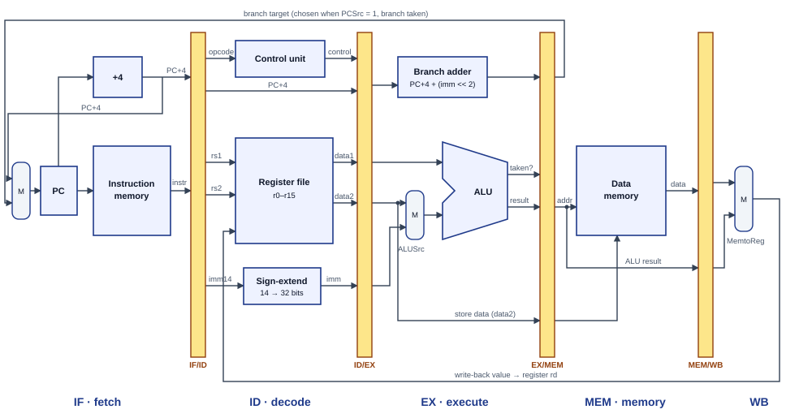

# LIMO — Milestone M2: Simulator Design

Team Binary Brains · CS3520 · AY 2026/2027

## 1. ISA frozen

The ISA is unchanged from M1 (16 registers, formats R/I/S/B, 15 instructions, 14-bit immediates).
All six worked encodings in the M1 specification are reproduced exactly by the assembler and
checked by automated tests (`node tests/run.js`).

**D1 feedback applied:** _(team to fill in: list each comment from Defence 1 and what changed)_

## 2. Architecture

The simulator is a static web page. There is no server: everything runs in the browser.

| File | Job |
| --- | --- |
| `index.html` | The page layout (panels and buttons) |
| `src/style.css` | Colours and layout |
| `src/assembler.js` | Text → 32-bit machine words (two passes) |
| `src/examples.js` | Built-in example programs |
| `src/pipeline-model.js` | The four pipeline registers as data |
| `src/pipeline.js` | The pipeline: one `step()` = one clock cycle (M3–M4) |
| `src/datapath.js` | Live datapath drawing (M4) |
| `src/views.js` | Control, hazard, narration, chart, register and memory panels (M4) |
| `src/app.js` | Connects buttons to the assembler and fills the tables |
| `tests/run.js` | Unit tests, run with `node tests/run.js` |

How the parts connect:

```
 user types program ──► app.js ──► assembler.js ──► program (list of words)
                          │                              │
                          ▼                              ▼
                   machine-code table          pipeline (M3) ──► register / memory views
```

## 3. Block diagram of the pipeline (datapath)



The drawn diagram is `docs/datapath.svg`; it is also shown on the live site in panel 3. Text version:

```
        ┌────┐  IF/ID  ┌────┐  ID/EX  ┌────┐  EX/MEM ┌─────┐  MEM/WB ┌────┐
 PC ──► │ IF │ ──║──► │ ID │ ──║──► │ EX │ ──║──► │ MEM │ ──║──► │ WB │
        └────┘         └────┘         └────┘         └─────┘         └────┘
  instruction        register file     ALU            data memory     write result
  memory             + control unit    + branch       (jarisa/ngola)  to register file
                     + sign extend     compare
```

- **IF** reads the instruction at PC from instruction memory; PC+4 goes to the next fetch.
- **ID** reads rs1/rs2 from the register file, sign-extends the immediate, and the control unit makes the signals.
- **EX** the ALU computes the result or memory address; branches compare rs1 and rs2 and compute the target. Branches are resolved here (M1 decision c).
- **MEM** jarisa reads data memory, ngola writes it.
- **WB** writes the ALU result or loaded value back to rd.

Instruction memory and data memory are separate (handout B2).

## 4. Pipeline-register data model

Defined in `src/pipeline-model.js`. Each register is a plain JavaScript object.

| Register | Fields | Why the next stage needs them |
| --- | --- | --- |
| IF/ID | pc, pcPlus4, instruction | ID decodes the instruction; branches need the PC |
| ID/EX | pc, pcPlus4, rs1, rs2, rd, readData1, readData2, imm, control | EX needs the operands and immediate; rs1/rs2/rd are used by the hazard unit |
| EX/MEM | rd, aluResult, storeData, branchTarget, branchTaken, control | MEM needs the address and store value; the branch result redirects the PC |
| MEM/WB | rd, aluResult, memData, control | WB chooses aluResult or memData using MemtoReg |

Every register also has `bubble: true/false`, used for stalls and flushes.

Control signals made in ID:

| Signal | 1 means |
| --- | --- |
| RegWrite | Write a result to rd |
| ALUSrc | ALU input B is the immediate (not rs2) |
| ALUOp | Which operation the ALU does |
| MemRead | Read data memory (jarisa) |
| MemWrite | Write data memory (ngola) |
| MemtoReg | Write-back value comes from memory, not the ALU |
| Branch | Instruction is lekana or fapane |

Signal values per instruction:

| Instruction | RegWrite | ALUSrc | MemRead | MemWrite | MemtoReg | Branch |
| --- | --- | --- | --- | --- | --- | --- |
| R-type (eketsa …) | 1 | 0 | 0 | 0 | 0 | 0 |
| eketsaI / kopanyaI / kapaI | 1 | 1 | 0 | 0 | 0 | 0 |
| jarisa | 1 | 1 | 1 | 0 | 1 | 0 |
| ngola | 0 | 1 | 0 | 1 | 0 | 0 |
| lekana / fapane | 0 | 0 | 0 | 0 | 0 | 1 |

## 5. Interface wireframe

```
┌──────────────────────────────────────────────────────────────┐
│ LIMO Simulator                                               │
├──────────────────────────────┬───────────────────────────────┤
│ 1. Program editor            │ 2. Machine code               │
│ [examples ▼] [Open] [Assemble]│ PC | source | fmt | bits | hex│
│ ┌──────────────────────────┐ │ fields colour-coded + spaced  │
│ │ eketsaI r1, r0, 7        │ │                               │
│ └──────────────────────────┘ │                               │
│ errors: "Line 3: ..."        │                               │
├──────────────────────────────┼───────────────────────────────┤
│ 3. Pipeline (M3/M4)          │ 4. Registers                  │
│ IF▸ID▸EX▸MEM▸WB  live values │ r0 lefela  0                  │
│ [Step][Run][Pause][Reset]    │ r1 n1      0 …                │
│ [x] Forwarding               │                               │
├──────────────────────────────┴───────────────────────────────┤
│ Later: control signals · hazards · data memory · timeline ·  │
│        statistics · narration (English + Sesotho)            │
└──────────────────────────────────────────────────────────────┘
```

The live page already follows this layout; panels 1, 2 and 4 work, panel 3 is a placeholder.

## 6. Assembler

Two passes:

1. **Pass 1** — read every line, strip comments (`#` or `;`), record each label's address. Each instruction adds 4 to the PC.
2. **Pass 2** — split each instruction into fields and pack them with shifts:
   - R: `(rd<<22) | (rs1<<18) | (rs2<<14) | (funct<<6)`
   - I/S/B: `(opcode<<26) | (A<<22) | (B<<18) | (imm14<<4)`
   - Branch displacement = `(label − (PC+4)) / 4`

Immediates may be decimal or hex (`0xC`) and are checked against −8192…8191.
Errors give the line number and a plain-language reason, e.g. `Line 2: "r16" is not a register.`

## 7. Tests

`node tests/run.js` runs 37 checks: the six M1 worked examples, every opcode/funct, negative/hex/limit
immediates, forward and backward branches, labels and comments, and eight error cases.
